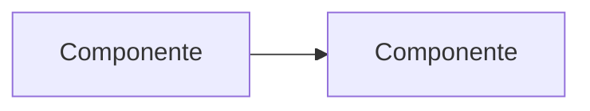

# Investigación de referentes — {{TITLE}}

- **Slug:** `{{SLUG}}`
- **Fecha de búsqueda:** {{DATE}}
- **Estado:** presentada | aceptada

## 1. Plan de búsqueda

- Caso de uso:
- Dominio:
- Stack del usuario:
- Términos en español:
- Términos en inglés:
- Sinónimos y variantes:
- Dominios adyacentes:
- Fuentes revisadas:
- Criterios de inclusión:
- Criterios de exclusión:

## 2. Resumen

<!-- qué se encontró, qué tan maduro es el ecosistema y qué limitaciones tuvo la búsqueda -->

## 3. Tabla de candidatos

| # | Proyecto | Enlace | Stack | Relevancia | Qué parte te sirve |
|---|---|---|---|---|---|
| 1 | | | | Alta | |
| 2 | | | | Media | |
| 3 | | | | Baja | |

## 4. Diagramas de las partes relevantes

### 4.1 <!-- Proyecto -->

- **Qué parte sirve para tu caso:**
- **Qué parte no aplica:**
- **Evidencia:** <!-- enlaces a README, código o documentación -->
- **Licencia / actividad:** <!-- solo si se verificó; si no, "no verificado" -->

### 4.2 <!-- Proyecto -->

- **Qué parte sirve para tu caso:**
- **Qué parte no aplica:**
- **Evidencia:**
- **Licencia / actividad:**

## 5. Patrones recurrentes

| Patrón | Dónde aparece | Qué resuelve | Coste observado |
|---|---|---|---|
| | | | |

## 6. Lecciones y fallos documentados

<!-- postmortems, límites, migraciones, problemas conocidos -->

## 7. Vacíos de la investigación

<!-- qué no se encontró, qué no se pudo verificar y qué queda fuera -->

## 8. Sesgos y límites

- Fecha de la búsqueda:
- Idiomas cubiertos:
- Acceso limitado a:
- Métricas no verificadas:

## 9. Fuentes

<!-- lista numerada con enlaces y qué se leyó de cada una -->

## 10. Aceptación de la Puerta A

- [ ] El usuario aceptó que los referentes son suficientes.
- Fecha:
- Frase literal:
