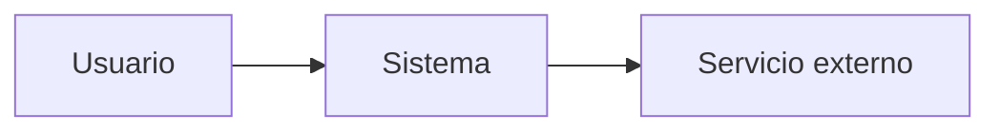
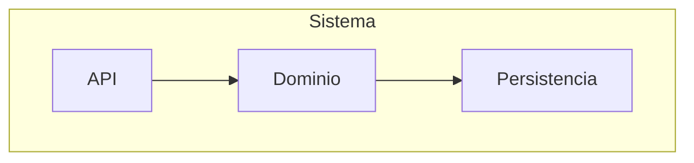
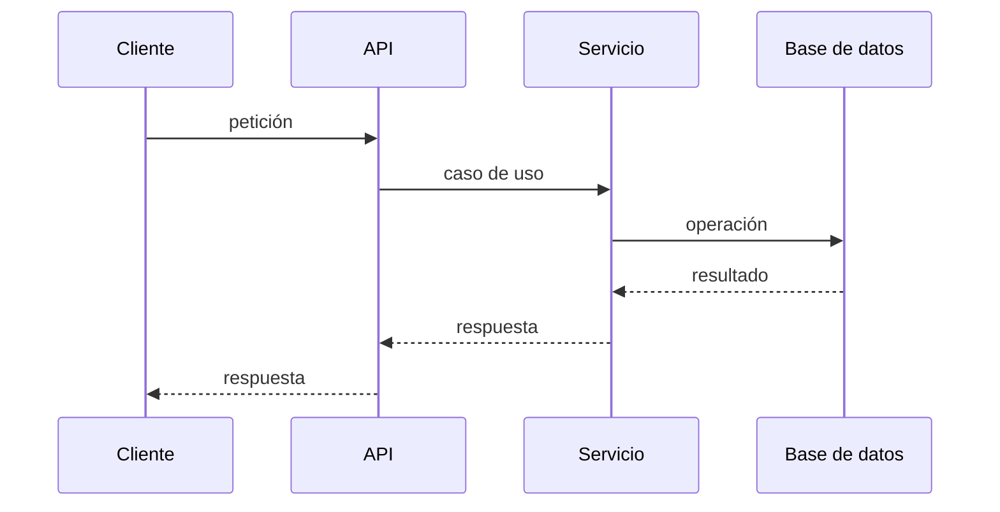

# Arquitectura propuesta — {{TITLE}}

- **Slug:** `{{SLUG}}`
- **Fecha:** {{DATE}}
- **Basada en:** <!-- arquitectura del usuario, rutas o enlaces -->
- **Estado:** pendiente de aprobación | aprobada

## 1. Entendimiento confirmado

<!-- resumen breve; enlaza 00-entendimiento.md -->

## 2. Leyenda

- `[USUARIO]`: definido en la arquitectura del usuario.
- `[REPO]`: convención verificada del repositorio.
- `[PROPUESTA]`: decisión de implementación que requiere aprobación.

## 3. Vista de contexto

## 4. Vista de componentes

## 5. Flujo principal

## 6. Modelo de datos

<!-- solo si aplica; no inventar tablas ni campos -->

## 7. Contratos e interfaces

| Interfaz | Tipo | Entrada | Salida | Errores | Origen |
|---|---|---|---|---|---|
| | | | | | |

## 8. Decisiones de implementación propuestas

| # | Decisión | Alternativas | Impacto | Origen |
|---|---|---|---|---|
| 1 | | | | `[PROPUESTA]` |

## 9. Matriz de robustez

| Preocupación | Decisión del usuario | Dónde se implementa | Test |
|---|---|---|---|
| Entradas inválidas | | | |
| Fallo de dependencia externa | | | |
| Reintentos / duplicados | | | |
| Concurrencia | | | |
| Límites de tamaño o rendimiento | | | |
| Observabilidad | | | |
| Migraciones / reversión | | | |
| Permisos / secretos | | | |

## 10. Riesgos y contradicciones

<!-- si queda algo sin resolver, no se pide aprobación -->

## 11. Fuera de alcance

<!-- lo que el usuario dijo explícitamente que no se hace -->

## 12. Aprobación de la Puerta C

- [ ] El usuario aprobó el diagrama.
- [ ] El usuario aprobó el árbol y el manifiesto de `03-plan-implementacion.md`.
- [ ] El usuario aprobó las dependencias.
- [ ] El usuario aprobó el plan de pruebas.
- Fecha:
- Frase literal:
