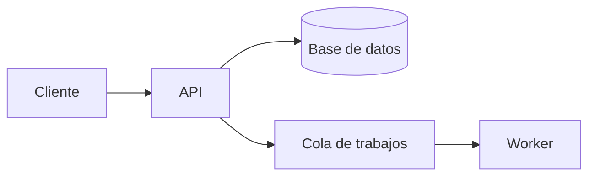

# Investigación de referentes

## Objetivo

Encontrar sistemas, proyectos y discusiones que se parezcan al caso del usuario, entender cómo resolvieron las partes que le sirven y documentar la evidencia. Esta fase **no** produce una arquitectura ni una recomendación de adopción. Produce un mapa de lo que existe y de lo que es relevante.

La investigación es para que el usuario decida mejor, no para que el agente decida por él.

## 1. Plan de búsqueda

Antes de buscar, escribe este plan en `01-investigacion.md`:

```text
- Caso de uso:
- Dominio:
- Stack del usuario (si lo definió):
- Términos en español:
- Términos en inglés:
- Sinónimos y variantes:
- Dominios adyacentes:
- Fuentes que se van a revisar:
- Criterios de inclusión:
- Criterios de exclusión:
- Fecha de la búsqueda:
```

Si el usuario no definió stack, no lo inventes. Busca patrones independientes del stack y dilo.

## 2. Fuentes y consultas

Usa las herramientas de búsqueda y lectura disponibles. No inventes resultados. Si una fuente no responde, regístralo.

### Repositorios

- GitHub: búsqueda de repositorios, código, issues y discussions.
- GitLab: búsqueda de proyectos y código.
- Awesome lists del dominio.
- Directorios de proyectos open source.

Consultas útiles:

```text
"<dominio>" architecture
"<dominio>" system design
"<dominio>" open source
"<dominio>" self-hosted
awesome <dominio>
"<dominio>" postmortem
"<dominio>" lessons learned
"<dominio>" scaling
```

Añade el stack cuando exista:

```text
"<dominio>" fastapi
"<dominio>" django
"<dominio>" rust
```

No te quedes con la primera página. Revisa resultados con distintos términos y ordenaciones. Si usas la API de GitHub, ten en cuenta el límite de peticiones sin autenticación y no lo agotes.

APIs útiles, si están disponibles:

- GitHub: `https://api.github.com/search/repositories?q=<consulta>`
- GitLab: `https://gitlab.com/api/v4/projects?search=<consulta>`
- Hacker News: `https://hn.algolia.com/api/v1/search?query=<consulta>`
- Stack Exchange: `https://api.stackexchange.com/2.3/search/advanced?order=desc&sort=relevance&q=<consulta>&site=stackoverflow`

Verifica la respuesta y cita la URL que consultaste. Si la API falla o está limitada, usa la búsqueda web o registra la limitación.

### Foros y discusiones

- Hacker News, incluida su API de búsqueda.
- Reddit: hilos de experiencias, no solo anuncios.
- Stack Overflow: preguntas sobre diseño y fallos concretos.
- Lobsters, dev.to, foros del stack.
- GitHub Discussions e issues de proyectos similares.

Busca también experiencias negativas:

```text
"<dominio>" problems
"<dominio>" limitations
"<dominio>" why we moved away
"<dominio>" outage
"<dominio>" migration
```

Las lecciones de fallo suelen ser más valiosas que la documentación de venta.

### Documentación, blogs y papers

- README, documentación de arquitectura, ADRs y guías de contribución.
- Blogs de ingeniería de empresas que resolvieron el mismo problema.
- Postmortems públicos.
- Papers y comparativas, si el dominio es académico.
- Charlas y transcripciones, si aportan decisiones verificables.

## 3. Criterios de selección

Incluye un candidato si:

- resuelve el mismo problema o uno muy cercano;
- tiene restricciones comparables (escala, latencia, equipo, despliegue);
- su código o documentación es accesible;
- aporta una parte concreta que el usuario podría estudiar;
- está activo o fue históricamente influyente y sigue siendo ilustrativo.

Excluye un candidato si:

- resuelve un problema distinto y solo comparte palabras clave;
- es un demo o un juguete sin decisiones defendibles;
- está abandonado y no tiene documentación;
- no puedes verificar que existe;
- es privado o inaccesible y no hay información pública suficiente.

No infles la lista. Si solo hay cuatro candidatos creíbles, presenta cuatro y explica el vacío.

## 4. Relevancia

Clasifica cada candidato como Alta, Media o Baja. Justifica en una frase:

- **Alta**: mismo problema, restricciones parecidas y una parte claramente aplicable.
- **Media**: mismo problema o restricciones parciales; sirve para comparar una decisión.
- **Baja**: solo inspiración conceptual o un aspecto aislado.

No uses estrellas, forks o años como sustituto de relevancia. Si citas una métrica, verifícala y anota la fecha.

## 5. Revisión profunda de los mejores

Para cada candidato profundo, revisa:

- estructura de carpetas y módulos;
- responsabilidades de los componentes principales;
- interfaces y contratos;
- modelo de datos;
- flujo principal y flujos de error;
- concurrencia, reintentos e idempotencia;
- estrategia de tests;
- despliegue y operación;
- licencia;
- issues o postmortems que revelen límites.

No leas todo el repositorio. Lee lo que responde al caso del usuario y cita la ruta concreta.

## 6. Diagramas de las partes relevantes

Dibuja solo las partes que sirven para el caso. Un diagrama de 5 a 10 nodos suele ser suficiente.



Reglas:

- Nombra los nodos como en el proyecto original, si eso ayuda a rastrear la evidencia.
- No dibujes componentes que no vas a explicar.
- Debajo del diagrama, escribe:
  - **Qué parte sirve para tu caso**;
  - **Qué parte no aplica**;
  - **Evidencia** (enlaces a README, código o documentación).
- Si Mermaid no renderiza, añade una lista de nodos y relaciones en texto.
- No presentes el diagrama como una recomendación. Es una descripción.

## 7. Tabla de candidatos

En el chat y en `01-investigacion.md`, usa una tabla simple:

| # | Proyecto | Enlace | Stack | Relevancia | Qué parte te sirve |
|---|---|---|---|---|---|
| 1 | ... | ... | ... | Alta | ... |
| 2 | ... | ... | ... | Media | ... |

Después de la tabla, desarrolla cada candidato profundo con su diagrama y sus notas. La tabla resume; el detalle justifica.

## 8. Síntesis

Cierra con:

- **Patrones recurrentes**: qué se repite entre los proyectos y por qué.
- **Trade-offs observados**: qué gana y qué pierde cada enfoque.
- **Lecciones y fallos**: incidentes, límites o migraciones documentadas.
- **Vacíos**: qué no encontraste, qué no pudiste verificar y qué queda fuera.
- **Sesgos**: fecha, idioma, acceso, sesgo hacia proyectos populares.

No termines con "mi recomendación es". Termina con "estas son las opciones observadas; tú decides".

## 9. Anti-alucinación

- No inventes repositorios, enlaces, estrellas, licencias, fechas ni citas.
- Si solo viste un resultado de búsqueda y no abriste el proyecto, dilo.
- Distingue "leído en el README" de "verificado en el código".
- Si un enlace no abre, márcalo como inaccesible y no lo uses como evidencia.
- No atribuyas una decisión a un proyecto sin una cita.
- No copies código en la investigación. Si el usuario quiere reutilizarlo, la licencia se revisa aparte.
- No envíes secretos, nombres de clientes, URLs privadas ni datos sensibles en las consultas. Usa términos genéricos.

## 10. Checklist antes de abrir la Puerta A

- [ ] Hay entre 6 y 10 candidatos, o una explicación del vacío.
- [ ] Hay entre 3 y 5 revisiones profundas.
- [ ] Cada candidato tiene enlace y motivo de relevancia.
- [ ] Cada diagrama tiene "qué sirve" y "qué no aplica".
- [ ] Hay al menos una fuente de foro o discusión, no solo repos.
- [ ] Hay lecciones de fallo si existen.
- [ ] Las métricas y licencias están verificadas o marcadas como no verificadas.
- [ ] La síntesis no contiene una decisión de arquitectura.
- [ ] El documento está guardado en `docs/dev-arquitecto-software/<slug>/01-investigacion.md`.
- [ ] El mensaje termina en la Puerta A y se detiene.
