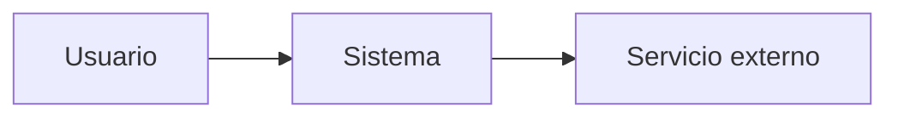
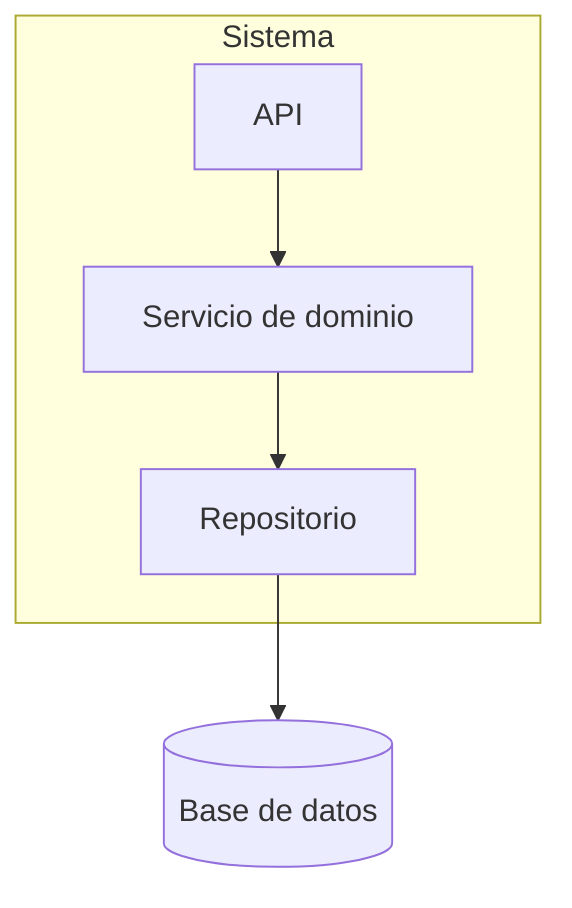
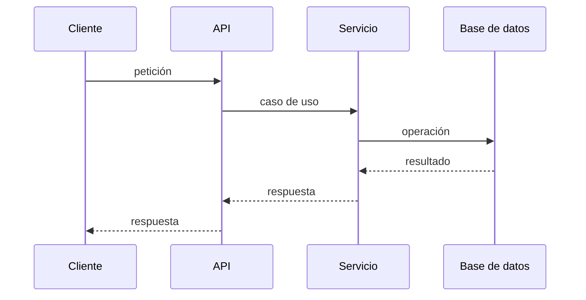

# Propuesta y plan de implementación

## Principio

La propuesta **formaliza** la arquitectura del usuario. No la rediseña, no la completa y no la "mejora". Si algo falta o se contradice, se pregunta; no se resuelve en el diagrama.

Cada elemento del diagrama debe poder rastrearse a:

- una frase de la arquitectura del usuario;
- una convención verificada del repositorio;
- una propuesta tuya marcada `[PROPUESTA]` y aprobada después.

## 1. Vistas

Incluye solo las vistas que el caso necesite.

### Contexto

Sistema, actores, sistemas externos y límites. Sirve para acordar qué entra y qué no.



### Componentes

Módulos, responsabilidades, interfaces y almacenes. Es la vista principal.



### Flujo

Diagrama de secuencia del caso principal y de los flujos de error que el usuario haya definido.



### Datos

Entidad-relación, si el caso tiene modelo de datos relevante. No inventes tablas ni campos.

### Despliegue

Solo si el usuario definió entornos, contenedores, red o servicios gestionados.

## 2. Marcas de origen

Usa una leyenda visible:

- `[USUARIO]`: está en la arquitectura entregada.
- `[REPO]`: es una convención verificada del repositorio, con archivo y línea.
- `[PROPUESTA]`: es una decisión de implementación que necesita aprobación.

En Mermaid, puedes usar un sufijo en la etiqueta:

```text
API [USUARIO]
Cache [PROPUESTA]
```

No mezcles las marcas. Si no sabes de dónde salió un elemento, no lo pongas.

## 3. Reglas para Mermaid

- Usa `flowchart` para componentes y `sequenceDiagram` para flujos.
- Nombra los nodos con los mismos términos que el usuario.
- Usa subgraphs para límites del sistema.
- Mantén cada diagrama por debajo de ~20 nodos; si es más grande, divídelo.
- Etiqueta las interfaces con el protocolo o contrato cuando el usuario lo haya definido.
- Añade una lista de nodos y relaciones debajo del diagrama para que se pueda leer sin render.
- No uses el diagrama para introducir componentes nuevos sin la marca `[PROPUESTA]`.

## 4. Árbol de archivos

Muestra solo lo relevante. No vuelques el repositorio completo.

```text
proyecto/
├── src/
│   ├── api/
│   │   └── routes.py                 ~ agregar POST /links
│   └── domain/
│       └── link.py                   + entidad y reglas
├── tests/
│   └── test_links.py                 + casos de aceptación
└── docs/dev-arquitecto-software/
    └── acortador/
        ├── 00-entendimiento.md
        ├── 01-investigacion.md
        ├── 02-arquitectura-propuesta.md
        └── 03-plan-implementacion.md
```

Notación:

- `+` archivo nuevo;
- `~` archivo modificado;
- `-` archivo eliminado.

Reglas:

- Rutas exactas, sin globs.
- Si un archivo existente se modifica, indica qué parte cambia.
- Si un archivo se elimina, justifícalo y pide confirmación explícita.
- Incluye los archivos de test y los documentos.
- Separa "archivos que se tocarán" de "archivos que solo se leerán".

## 5. Manifiesto de archivos

| # | Ruta | Acción | Responsabilidad | Motivo | Interfaces | Test |
|---|---|---|---|---|---|---|
| 1 | `src/domain/link.py` | Crear | Entidad y validación | Regla de negocio del acortador | `Link`, `create_link` | `tests/test_link.py` |
| 2 | `src/api/routes.py` | Modificar | Endpoints | Exponer el caso de uso | `POST /links`, `GET /{code}` | `tests/test_api.py` |

Reglas:

- Cada fila es un archivo concreto.
- La acción es crear, modificar o eliminar.
- La responsabilidad explica qué hace, no cómo.
- Las interfaces listan nombres de clases, funciones, endpoints o eventos.
- El test asociado debe existir en el plan.
- Si no sabes una ruta, propón una y márcala `[PROPUESTA]`; no la des por hecha.
- No incluyas archivos "por si acaso". El manifiesto es un contrato de alcance.

## 6. Matriz de robustez

Si la arquitectura no responde a estos puntos y son relevantes, pregúntalos en la Fase 2. En el plan, registra la decisión del usuario:

| Preocupación | Decisión del usuario | Dónde se implementa | Test |
|---|---|---|---|
| Entradas inválidas | | | |
| Fallo de dependencia externa | | | |
| Reintentos / duplicados | | | |
| Concurrencia | | | |
| Límites de tamaño o rendimiento | | | |
| Observabilidad | | | |
| Migraciones / reversión | | | |
| Permisos / secretos | | | |

No dejes celdas vacías. Si no aplica, escribe "no aplica" y por qué. No inventes la decisión.

## 7. Orden de implementación

Divide en lotes pequeños y verificables:

```text
### Lote 1 — Contratos y tipos
- Archivos:
- Cambios:
- Test:
- Comando:
- Criterio de terminado:

### Lote 2 — Lógica de dominio
...

### Lote 3 — Adaptadores e IO
...

### Lote 4 — API y wiring
...

### Lote 5 — Verificación completa
...
```

El orden debe reducir riesgo: primero contratos y tests, luego dominio, luego IO, luego integración. Si el repositorio ya tiene un orden establecido, síguelo.

## 8. Plan de pruebas

Incluye:

- pruebas unitarias por regla de negocio;
- pruebas de integración por interfaz;
- pruebas de extremo a extremo por criterio de aceptación;
- casos de error y límites que el usuario haya definido;
- comandos exactos y resultado esperado;
- línea base antes de cambiar código.

No inventes criterios de aceptación. Si el usuario no los dio, pregúntalos en la Fase 2.

## 9. Mensaje de aprobación

El mensaje final de la Fase 3 debe ser corto y concreto:

```text
## Puerta C
Revisa el diagrama, el árbol y el manifiesto.
Responde APROBADO si quieres que implemente exactamente esto, o dime qué cambio.
No escribiré código hasta tu aprobación.
```

Si el usuario aprueba solo el diagrama, pregunta si también aprueba el árbol, el manifiesto, las dependencias y las pruebas.

## 10. Solicitudes de cambio

Si el usuario pide un cambio después de aprobar:

1. No lo implementes todavía.
2. Explica qué cambia: arquitectura, archivos, dependencias, tests o alcance.
3. Actualiza `02-arquitectura-propuesta.md` y `03-plan-implementacion.md`.
4. Muestra el diff o la sección afectada.
5. Pide una nueva aprobación explícita.
6. Solo entonces vuelve a la Fase 4.

Registra el cambio en `04-registro-implementacion.md` con fecha y motivo.

## Checklist antes de la Puerta C

- [ ] El diagrama se rastrea a la arquitectura del usuario y a `[PROPUESTA]` aprobadas.
- [ ] No hay componentes nuevos sin marca.
- [ ] El árbol usa rutas exactas y la notación `+`, `~`, `-`.
- [ ] El manifiesto cubre todos los archivos que se tocarán.
- [ ] Las dependencias nuevas están listadas y no instaladas.
- [ ] Cada lote tiene verificación y criterio de terminado.
- [ ] Cada criterio de aceptación tiene test o evidencia.
- [ ] La matriz de robustez está completa o marcada "no aplica".
- [ ] No quedan preguntas bloqueantes ni supuestos.
- [ ] El mensaje termina en la Puerta C y se detiene.
